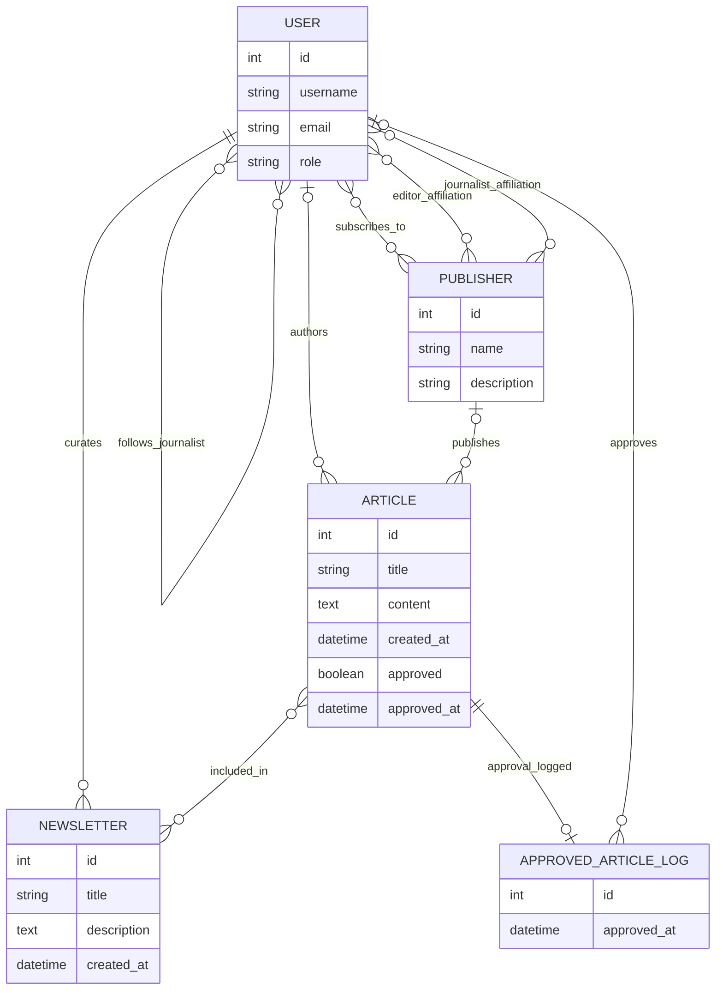

# News 4 U: architecture and data model

## Application layout

The Django project root is the `news_application_project` directory, which
contains `manage.py`.

| Path | Responsibility |
| --- | --- |
| `config/` | Django settings, root URLs, ASGI and WSGI entry points. |
| `accounts/` | Custom user, Reader registration/subscriptions, role groups, authentication and role permissions. |
| `publications/` | Publisher model, website management pages and forms, API serializer. |
| `articles/` | Article and Newsletter models, site/API views, forms, serializers, approval services and administration. |
| `templates/` | Responsive site pages, authentication pages and role workspaces. |
| `static/news/site.css` | Website styles. |
| `tests/` | Django automated tests for account, role, API and website workflows. |
| `requirements.txt` | Python runtime dependencies. |
| `.env.example` | Documented configuration variables; contains placeholders, not credentials. |

## Data model

### Normalization and invariants

- User identity and role are stored once. Reader subscriptions and publication
  affiliations are explicit many-to-many join relations.
- Articles refer to authors and publishers instead of copying their details.
  The database requires each article to have an author and/or publisher.
- A newsletter has one journalist author and relates to stories through a
  many-to-many join relation.
- Approval metadata is stored on Article; `ApprovedArticleLog` separately
  records the locally simulated external distribution event.
- A Reader's subscription fields serialize as `null` for non-Readers, and
  changing a user's role clears their Reader subscriptions if they are no
  longer a Reader.
- Deleting an author/publisher referenced by articles is restricted to prevent
  orphaned editorial content.

## Role authorization

Groups `Reader`, `Editor`, and `Journalist` are provisioned after migrations.
Role assignment places users into their corresponding group. When a user is
added to a role group, the user role is synchronized from that group. The role
permissions managed by the post-migrate signal are limited to Article and
Newsletter:

| Group | Django model permissions |
| --- | --- |
| Reader | View Article and Newsletter. |
| Editor | View/change/delete Article; view/add/change/delete Newsletter. |
| Journalist | Add/view/change/delete Article and Newsletter. |

Page and API views additionally enforce business rules such as Reader
subscription filtering and Journalist ownership. Those checks are required
because model/group permissions alone do not express per-object ownership or
the approval workflow.

## Article approval flow

1. A Journalist submits an Article. It is saved with `approved=False`.
2. The Editor reviews the submission and may make corrections.
3. The Editor approves it. Approval time and approving user are saved.
4. The approval service POSTs the article payload to the app's configured
   `/api/approved/` endpoint using the private internal key.
5. The local endpoint validates the Article and upserts its approval log.
6. Readers subscribed to the article's Journalist and/or Publisher receive an
   email. The app avoids duplicate recipients.

Email and internal HTTP integrations have explicit failures. An integration
failure is surfaced to the Editor; it does not silently revert the persisted
approval.

## Website and API separation

The main site is rendered with Django templates. Role-specific navigation goes
to normal Django form pages and hides actions a role cannot perform. Every view
also checks permissions server-side.

The REST API remains in place for machine clients and API testing. API tokens
use DRF's token authentication; session authentication is enabled for the
browsable API. The same domain models and approval service are used by website
and API workflows.
